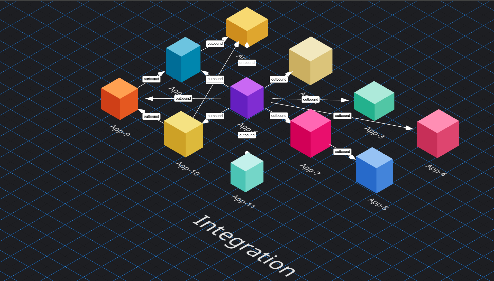

# Isometric Frontend

Configurable isometric frontend concept



## Usage

You need to have node.js and npm. First you need to install the dependencies and then run it locally or build it.

```sh
# Install the dependencies
npm install

# For local development
# it will open on localhost:3000
npm run dev

# To build the application
npm run build
```

## Configuration

There are two main things to configure. One is the sections and the other is the connections.
The sections show up as the blocks of the pyramid and they also have there own areas.
A section has a name, a description, an icon and an array of the models to show.
The models have a shape, size, position and color and a name.
